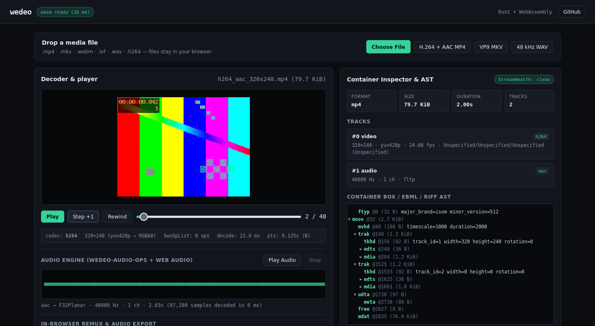

# Wedeo

Wedeo is a Rust media toolkit that lets you look inside a video file, decode its frames, and change how its audio and video are packaged. The same H.264 and VP9 decoders run in the command-line tool and in a browser through WebAssembly.



[Open the studio](https://wedeo.sharifhsn.dev/) · [Download the standalone studio](https://wedeo.sharifhsn.dev/downloads/Wedeo.zip)

## Try the command line

Run Wedeo directly from [PyPI](https://pypi.org/project/wedeo/) with [uv](https://docs.astral.sh/uv/). Start with a familiar FFmpeg command. This one changes the container from MP4 to Matroska and copies the encoded tracks:

```sh
uvx wedeo ffmpeg -i input.mp4 -c copy output.mkv
uvx wedeo ffprobe -show_streams -of json output.mkv
```

For transformations, choose whichever spelling you prefer. These commands both convert a WAV file to 16 kHz mono:

```sh
uvx wedeo ffmpeg -i input.wav -ar 16000 -ac 1 ffmpeg-style.wav
uvx wedeo transcode -i input.wav --sample-rate 16000 --channels 1 -o native-style.wav
```

Use `uvx wedeo --help` to explore the native commands or `uvx wedeo studio` to open the browser studio. The FFmpeg interface supports a subset of FFmpeg options. The prebuilt wheel runs on x86-64 Linux with glibc 2.39 or later. Source installs require Rust and NASM.

### What happens to the second audio track?

In a two-second test clip with one H.264 video track and two distinct AAC audio tracks, FFmpeg 7.1.5 selected one video and one audio track for `-c copy`. Wedeo 0.3.1 copied all three to Matroska. FFmpeg also copied all three with `-map 0 -c copy`. We compared the SHA-256 of every encoded packet in stream order: 48 video packets and 95 packets per audio track. This example checks track selection and payloads; timestamps and container metadata have separate semantics.

To reproduce from this checkout with FFmpeg, FFprobe, Python 3, and uv installed, run `python3 scripts/check_multitrack_remux.py`. [User report](https://ffmpeg.org/pipermail/ffmpeg-user/2012-May/006470.html) · [FFmpeg stream selection](https://ffmpeg.org/ffmpeg.html#Automatic-stream-selection)

## Run the studio locally

With Rust installed through rustup, run these commands from the repository root. The build uses the toolchain pinned in `rust-toolchain.toml`. Python 3 serves the demo locally.

```sh
rustup target add wasm32-unknown-unknown
./web/build.sh
python3 -m http.server 8000 --bind 127.0.0.1 --directory web
```

Open [the local studio](http://127.0.0.1:8000/). It starts with a two-second H.264 clip. Click **Step +1** to see the next decoded frame, play its audio, or inspect the MP4 box tree. You can also drop in a file of your own. The browser processes it locally.

## Inside the project

- [Codecs](codecs) and [containers](formats) implement H.264, VP9, PCM, MP4, Matroska, IVF, and WAV. [Adapters](adapters) provide AV1 encoding and decoding and additional audio decoders. The optional rav1d decoder uses a dav1d-compatible FFI boundary and assembly optimizations.
- [The Rust library](crates/wedeo/README.md) exposes typed audio and video readers. Its feature flags support an audio-only build.
- [The wgpu backend](crates/wedeo-gpu-wgpu) can run scaling and color conversion on a GPU. Build the CLI with `--features gpu-wgpu` and pass `--gpu` to a transcode that requests scaling. The CLI reports the selected adapter or why it fell back to the CPU.
- [The test harness](tests/wedeo-oracle) compares selected decoder output with a pinned FFmpeg revision. [Known differences](DIVERGENCES.md) describe where behavior varies.

[Architecture](docs/ARCHITECTURE.md) · [Contributing](CONTRIBUTING.md) · [Historical development notes](docs/history) · [LGPL-2.1-or-later license](LICENSE)
