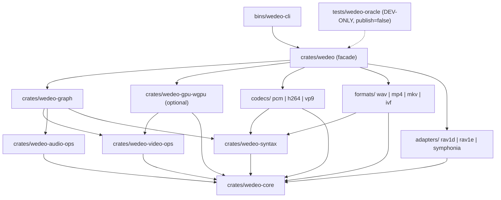

# Wedeo Architecture Specification

> **Status:** Locked Architectural Specification (`docs/ARCHITECTURE.md`)
> **Target Oracle:** FFmpeg `n9.1` ("Gauss", commit `74e4393595cf2b5857f0da925c4e0dd74ea306e5`) | **Language:** 100% Pure Rust | **License:** `LGPL-2.1-or-later`

---

## 1. System Thesis & 10 Locked Invariants

**Wedeo is a pure-Rust Universal A/V Adapter** — a deterministic, streaming media compiler and runtime combining **exact algorithmic ports of FFmpeg `n9.1`** (codecs, containers, `SwsOpList`, `libswresample` math) with a clean, data-oriented, GPU-considerate Rust architecture.

### The 10 Golden Invariants

1. **100% Pure Rust (Zero FFI / Zero Vendored ASM):** No `.S` files, no `cc` `build.rs`, no `bindgen`, no `c2rust`. Fast paths use Data-Oriented Design (DOD) first, then `core::arch` SIMD verified bit-exact against pure-Rust scalar reference kernels.
2. **Exact FFmpeg `n9.1` Algorithmic Cores:** Every native codec, container, `SwsOpList` op, and `libswresample` kernel translates FFmpeg `n9.1` C algorithms faithfully (using explicit wrapping math for C `-fwrapv` parity) inside clean, modular `#![forbid(unsafe_code)]` Rust modules.
3. **VFR-Native Everywhere:** The entire engine thinks in Variable Frame Rate. Every `Packet` and `MediaUnit` carries exact rational `(pts, dts, duration, time_base)`. `avg_frame_rate` is advisory metadata only — never `frame_index / fps`. CFR conversion occurs only when explicitly requested or mandated by a CFR-only container.
4. **Data-Oriented Design (DOD) First:** Synchronous flat-indexed DAG (`NodeId(u32)`, `EdgeId(u32)`), strip/tile L1-cache-resident `SwsOpList`, 1024-sample L1-resident planar `AudioOpList` slabs, SoA `MacroblockGrid`, zero-alloc steady-state scratch arenas, and warm pooled `BorderedPlane`s — profile before adding stage threads.
5. **GPU-Considerate from Day 1 (`wgpu` WGSL):** Memory residency (`Cpu | Gpu(GpuDeviceId)`) is orthogonal to `PixelLayout` and `ColorDesc`. `wedeo-core` defines a zero-dependency `GpuSurface` trait; optional `wedeo-gpu-wgpu` accepts external `(Arc<wgpu::Device>, Arc<wgpu::Queue>)` (for zero-copy Tessera handoff) and compiles `SwsOpList` + custom `WgslFilter`s into cached WGSL compute shaders with zero-ping-pong domain placement.
6. **Strong Audio / Video Separation:** Audio-only consumers depend only on `wedeo-core` + `wedeo-audio-ops` + audio codecs/formats — compiling zero video decoders, zero `SwsOpList`, and zero `wgpu`, with typed `wedeo::audio::AudioReader` APIs.
7. **Zero Dev-Verification Slop in Production:** Zero `CompatMode`, `RegistryPolicy`, `ConformanceTier`, `Determinism`, `<T: TraceSink>` generics, `inventory` globals, or `SideData::RawFfmpeg` in production APIs. All FFmpeg verification (`framecrc`, `audiogen`, `checkasm`, `bisect`, Miri, DAG lints) lives exclusively in `tests/wedeo-oracle` and `tools/` (with stage dumps strictly behind `#[cfg(feature = "dev-trace")]`).
8. **Zero UB, Zero Panics on Untrusted Inputs:** `#![forbid(unsafe_code)]` everywhere except tiny audited primitives (`RowProgressPlane`, aligned buffer alloc, `core::arch` SIMD intrinsics, `wedeo-rav1d` adapter). Corrupt streams default to FFmpeg-resilient recovery tracked in a lightweight inline `StreamHealth` ledger (`--strict` fails immediately).
9. **Lossless Preservation & Convenient Transparency:** `--preserve-all` by default (preserves all tracks, chapters, attachments, HDR metadata, display rotation). Auto-adapter picks maximum-precision bridges and emits concise 1-line notes on implicit lossy conversions (`--strict` rejects implicit lossy steps).
10. **Uniform `LGPL-2.1-or-later` License** across the workspace (optional `GPL` feature gate only if GPL components are ever added).

---

## 2. Exact Workspace Layout & Dependency DAG (17 + 1 + 1 Crates)

Dependencies flow strictly downward. Zero `inventory` link-time globals. Zero layer inversions. `wedeo-play` is cut (UI/windowing lives externally in Tessera).



### Crate Inventory (17 Product + 1 Optional GPU + 1 Dev-Only = 19 Crates)

| Layer | Crate | Role (One-Line Justification) |
|---|---|---|
| **L0** | `crates/wedeo-core` | Lean foundation (`bitflags` only, `<1s` compile): `common`/`audio`/`video`/`clock` types, `BorderedPlane`, `RowProgressPlane`, `GpuSurface`, `BitReader`, `StreamHealth`, I/O/codec/format traits, and concrete `Registry`. |
| **L1** | `crates/wedeo-video-ops` | Pure-Rust port of FFmpeg `n9.1` `SwsOpList` v10: optimizer + strip-fused CPU scalar/`core::arch` SIMD for scaling, pixel layout, chroma siting, colorimetry, HDR tone-mapping, crop, and rotation. |
| **L1** | `crates/wedeo-audio-ops` | Fused `AudioOpList` compiler uniting FFmpeg `n9.1` `libswresample` polyphase/rematrix/dither math with cost-optimal downmix-before-resample, gain/loudness, and 1024-sample L1 slabs. |
| **L1** | `crates/wedeo-syntax` | `#![no_std]`, `#![forbid(unsafe_code)]`, feature-gated (`h264`, `vp9`, `av1`, `aac`, `hevc`) CBS/BSF/extradata/inspection syntax crate + generic `RawStreamDemuxer<ElementaryFramer>`. |
| **L1** | `crates/wedeo-graph` | Flat-indexed VFR-native synchronous `CompiledGraph`, auto-adapter UX, `Timeline` algebra (edit lists/gapless/smart-cut), ~10 core filters, and first-class custom `VideoFilter`/`AudioFilter`/`WgslFilter` framework. |
| **L1b** | `crates/wedeo-gpu-wgpu` | Optional `wgpu` backend accepting external `(Arc<Device>, Arc<Queue>)`, wrapping `wgpu::Texture` as `GpuSurface`, and compiling `SwsOpList` + `WgslFilter` into cached WGSL compute shaders. |
| **L2a** | `codecs/wedeo-codec-pcm` | Native bit-exact FFmpeg PCM decoders + 17 encoders (restores native decode). |
| **L2a** | `codecs/wedeo-codec-h264` | Pure-Rust FFmpeg `n9.1` H.264 decoder over `BorderedPlane`/`RowProgressPlane`/SoA `MacroblockGrid`/`wedeo-syntax` + `core::arch` SIMD. |
| **L2a** | `codecs/wedeo-codec-vp9` | Pure-Rust FFmpeg `n9.1` VP9 decoder with sound split-tile parallelism, zero-alloc scratch, odd-dim & Profile 1–3 support, + `core::arch` SIMD. |
| **L2a** | `formats/wedeo-format-wav` | Native bit-exact FFmpeg RIFF/RIFX/RF64/BW64 demuxer + muxer (restores native demux). |
| **L2a** | `formats/wedeo-format-mp4` | Native ISOBMFF/MOV demuxer (`elst`/`colr`/`pasp`/rotation/audio/box AST) + muxer (faststart `moov`-first when seekable; auto-fragmented `moof`/`mdat` CMAF when non-seekable). |
| **L2a** | `formats/wedeo-format-mkv` | Complete native Matroska/WebM EBML demuxer + muxer (video, audio, subtitles, chapters, Cues, EBML AST); replaces video-only `webm`. |
| **L2a** | `formats/wedeo-format-ivf` | Tiny VP8/VP9/AV1 elementary container demuxer + muxer. |
| **L2b** | `adapters/wedeo-rav1d` | Segregated AV1 decode adapter (zero-copy `CpuExternal`, fixed odd-dim chroma & colorimetry). |
| **L2b** | `adapters/wedeo-rav1e` | Segregated AV1 encode adapter (`Encoder::extradata()`, VFR PTS preservation, `EncodeHint`). |
| **L2b** | `adapters/wedeo-symphonia` | Segregated fallback audio adapter (owns `ByteSource` cleanly — no `DeadIo`; subordinate to native WAV/PCM; fixed `track_id`). |
| **L3** | `crates/wedeo` | Ergonomic Rust library facade with feature-gated `default_registry()`, typed `wedeo::audio::AudioReader`, and `wedeo::video::VideoReader`. |
| **L3** | `bins/wedeo-cli` | Unified `wedeo` binary: 5 typed `serde` ops driving primary CLI (`inspect`/`transcode`/`cut`/`mux`/`explain`), lean `wedeo ffmpeg` (`lexopt`), and `wedeo mcp`. |
| **Dev** | `tests/wedeo-oracle` | Non-published dev harness: FFmpeg `n9.1` oracle, all-pixfmt/all-column `framecrc`, `audiogen`, `checkasm`, `dhat` 0-alloc gate, Miri tests, DAG lint, `dev-trace` bisector. |

*Explicitly deferred until the core passes its tests:* `wedeo-metrics` (SSIMULACRA2/PSNR/SSIM/scene-cut/chunked encode), `wedeo-package` (HLS/DASH manifests), `wedeo-net` (HTTP/RTMP/SRT/WebRTC), `wedeo-hw` (VA-API/VideoToolbox/NVDEC/Vulkan Video), `bindings/wedeo-{py,capi,wasm}`.

---

## 3. Frozen Concrete Rust API Blueprints

Cheaper models implement *against* these frozen signatures and never invent replacement Layer 0–1 traits.

### 3.1 `wedeo-core` (Foundation Types, Buffers, Traits & Clock)

```rust
// --- Time (VFR-native, exact FFmpeg Rational math) ---
#[derive(Clone, Copy, PartialEq, Eq, Hash)]
#[repr(transparent)]
pub struct Timestamp(i64); // i64::MIN == NONE (AV_NOPTS_VALUE); checked_add/rescale prevent NOPTS bugs

#[derive(Clone, Copy, PartialEq, Eq, Hash)]
pub struct Rational { pub num: i32, pub den: i32 } // Exact FFmpeg av_rescale_rnd / av_reduce / av_cmp_q

// --- Orthogonal Video Layout & Colorimetry ---
#[derive(Debug, Clone, Copy, PartialEq, Eq, Hash)]
pub struct PixelLayout {
    pub model: ColorModel,           // Ycbcr | Rgb | Gray | Xyz
    pub packing: PlanePacking,       // Planar | SemiPlanar | Packed
    pub subsampling: Subsampling,    // Cs444 | Cs422 | Cs420 | Cs411 | Cs410 | Cs400
    pub depth: SampleDepth,          // U8 | U10 | U12 | U14 | U16 | F16 | F32
    pub endian: Endian,              // Little | Big
    pub alpha: AlphaMode,            // None | Straight | Premultiplied
    pub order: CompOrder,            // Yuv | Rgb | Bgr | Rgba | Bgra | Argb | Abgr | Uyvy | Yuyv
}

#[derive(Debug, Clone, Copy, PartialEq, Eq, Hash, Default)]
pub struct ColorDesc {
    pub primaries: ColorPrimaries,         // H.273 / CICP
    pub transfer: TransferCharacteristic,  // BT.709, sRGB, PQ (ST 2084), HLG, Linear...
    pub matrix: MatrixCoefficients,        // BT.709, BT.601, BT.2020 NCL/CL, Identity...
    pub range: ColorRange,                 // Unspecified | Limited | Full
    pub chroma_location: ChromaLocation,   // Unspecified | Left | Center | TopLeft...
}

#[derive(Debug, Clone)]
pub enum SideData {
    DisplayMatrix([i32; 9]),
    MasteringDisplay(MasteringDisplayMeta),
    ContentLightLevel { max_cll: u32, max_fall: u32 },
    Hdr10Plus(Buffer),
    DolbyVisionRpu(Buffer),
    IccProfile(Buffer),
    SampleTrim { skip_start: u32, skip_end: u32 },
    ReplayGain(ReplayGain),
    ClosedCaptionsA53(Buffer),
}

// --- Zero-Copy Memory Residency & Sound Concurrency ---
pub const SIMD_ALIGN: usize = 64;
pub const SIMD_TAIL_PADDING: usize = 64;

#[derive(Debug, Clone, Copy, PartialEq, Eq, Hash)]
pub enum MemoryDomain { Cpu, Gpu(GpuDeviceId) }

pub trait GpuSurface: Send + Sync + 'static {
    fn device_id(&self) -> GpuDeviceId;
    fn layout(&self) -> PixelLayout;
    fn width(&self) -> u32;
    fn height(&self) -> u32;
    fn as_any(&self) -> &dyn std::any::Any;
    fn export_native(&self) -> Option<NativeGpuHandle> { None }
}

/// 64B-aligned ref-counted buffer: CpuPooled | CpuExternal (rav1d/mmap) | Gpu(Arc<dyn GpuSurface>).
/// Provides zero-copy `subslice(Range<usize>)`, `data_with_padding()`, and `try_data_mut()`.
#[derive(Clone)]
pub struct Buffer { /* Arc<BufferInner> */ }

/// 2D plane with explicit top/bottom/left/right border padding + `extend_edges()` + `origin_offset`.
/// Eliminates MC edge fallbacks, negative pointer arithmetic, and per-block scratch copies.
#[derive(Clone)]
pub struct BorderedPlane {
    pub buffer: Buffer,
    pub origin_offset: usize,
    pub stride: isize,
    pub width_bytes: usize,
    pub height: usize,
    pub border: BorderPadding,
}

/// Miri-verified row-progress picture for frame-level threading:
/// - `PlaneRowWriter` (!Clone) borrows ONLY unpublished rows `[published_end..height]` as `&mut [u8]`.
/// - `PlaneRowReader` (Clone+Sync) waits via Acquire and borrows ONLY `[0..observed_published]` as `&[u8]`.
/// - `finish(self) -> BorderedPlane` transitions zero-copy into the output `VideoFrame`.
pub struct PlaneRowWriter { /* ... */ }
pub struct PlaneRowReader { /* ... */ }

// --- Unified Payloads (VFR-native: every unit carries time_base) ---
pub struct Packet {
    pub data: Buffer,
    pub track_id: TrackId,
    pub pts: Timestamp,
    pub dts: Timestamp,
    pub duration: i64,
    pub time_base: Rational,
    pub pos: Option<u64>,
    pub flags: PacketFlags,
    pub side_data: Vec<SideData>,
}

pub enum MediaUnit {
    Video(VideoFrame),       // planes/GpuSurface, width, height, layout, color, crop, sar, flags, side_data, pts, duration, time_base
    Audio(AudioBlock),       // planes, nb_samples, format, sample_rate, channel_layout, pts, duration, time_base, side_data
    Subtitle(SubtitleEvent), // start, duration, time_base, SubtitlePayload::{Text|Ass|WebVtt|Bitmap(PositionedPlane)}
    TimedData(TimedData),    // schema_tag, payload: Buffer, pts, duration, time_base
}

// --- Lightweight Health & Error Policy ---
#[derive(Debug, Clone, Copy, PartialEq, Eq, Default)]
pub enum ErrorPolicy { #[default] Resilient, Strict }

#[derive(Debug, Default, Clone)]
pub struct StreamHealth {
    pub corrupt_packets: u64,
    pub concealed_frames: u64,
    pub concealed_blocks: u64,
    pub timestamp_glitches: u64,
    pub dropped_bytes: u64,
    pub clipped_audio_samples: u64,
    pub events: Vec<HealthEvent>, // Capped at 64 entries
}

// --- Capability-Clean I/O (Fallible Seek — pipes & files unified, zero DeadIo!) ---
pub trait ByteSource: std::io::Read + Send {
    fn is_seekable(&self) -> bool { false }
    fn seek(&mut self, _pos: std::io::SeekFrom) -> std::io::Result<u64> {
        Err(std::io::Error::new(std::io::ErrorKind::NotSeekable, "non-seekable source"))
    }
    fn size_hint(&self) -> Option<u64> { None }
}

pub trait ByteSink: std::io::Write + Send {
    fn is_seekable(&self) -> bool { false }
    fn seek(&mut self, _pos: std::io::SeekFrom) -> std::io::Result<u64> {
        Err(std::io::Error::new(std::io::ErrorKind::NotSeekable, "non-seekable sink"))
    }
}

// --- Control-Flow Status (Zero heap Error::Again/Eof abuse!) ---
pub enum RecvStatus<T> { Ready(T), NeedMore, Eof }
pub enum SendStatus { Accepted, Full }

// --- Container & Codec Traits ---
pub trait Demuxer: Send {
    fn header(&self) -> &ContainerHeader; // tracks (StreamParams::Video|Audio|Subtitle|Data), chapters, attachments, edit_lists, metadata
    fn read_packet(&mut self) -> Result<RecvStatus<Packet>, Error>;
    fn seek(&mut self, target: SeekTarget) -> Result<(), Error>;
    fn health(&self) -> &StreamHealth;
}

pub trait Muxer: Send {
    fn write_header(&mut self, header: &ContainerHeader) -> Result<(), Error>;
    fn write_packet(&mut self, pkt: &Packet) -> Result<(), Error>;
    fn finalize(self: Box<Self>) -> Result<(), Error>;
}

pub struct CodecContext {
    pub pool: Arc<BufferPool>,
    pub threads: usize, // 0 = auto, 1 = inline (no threads)
    pub error_policy: ErrorPolicy,
}

pub trait Decoder: Send {
    fn send_packet(&mut self, pkt: Option<&Packet>) -> Result<SendStatus, Error>;
    fn receive(&mut self) -> Result<RecvStatus<MediaUnit>, Error>;
    fn flush(&mut self);
    fn health(&self) -> &StreamHealth;
}

#[derive(Debug, Clone, Copy, Default)]
pub struct EncodeHint {
    pub force_keyframe: bool,
    pub target_qp: Option<i32>,
}

pub enum PassMode { Single, FirstPass, SecondPass(Buffer) }

pub trait Encoder: Send {
    fn extradata(&self) -> &[u8]; // Ready after open() — fixes av1C / avcC plumbing!
    fn send_unit(&mut self, unit: Option<&MediaUnit>, hint: EncodeHint) -> Result<SendStatus, Error>;
    fn receive_packet(&mut self) -> Result<RecvStatus<Packet>, Error>;
    fn take_pass_stats(&mut self) -> Option<Buffer> { None }
    fn flush(&mut self);
}

// --- Plain Concrete Registry (Zero inventory globals!) ---
pub struct Registry { /* plain Vecs of DemuxerFactory, MuxerFactory, DecoderFactory, EncoderFactory */ }

// --- Optional Headless Clock Helper (`wedeo_core::clock`, ~150 LOC, zero extra deps) ---
pub mod clock {
    pub struct AudioClock { /* ffplay pts_drift model + pause + speed */ }
    #[derive(Clone, Copy, PartialEq, Eq)]
    pub struct SeekEpoch(pub u64);
}
```

### 3.2 `wedeo-video-ops` (`SwsOpList`) & `wedeo-gpu-wgpu`

```rust
// In wedeo-video-ops (ZERO wgpu dependency!)
pub enum SwsOp {
    Read { layout: PixelLayout, crop: CropRect, display_matrix: [i32; 9] },
    Unpack { depth: SampleDepth, shift: u8 },
    Swizzle([u8; 4]),
    Linearize(TransferCharacteristic),
    ColorMatrix([[f32; 4]; 3]),          // Constant-folded YUV↔RGB + gamut matrix
    ToneMap(ToneMapOp),                  // BT.2390 / Hable / Clip
    ScaleH { dst_w: u32, kernel: SwsScaler, chroma_loc: ChromaLocation },
    ScaleV { dst_h: u32, kernel: SwsScaler, chroma_loc: ChromaLocation },
    BlendAlpha,                          // Fused bitmap subtitle / overlay blend
    Delinearize(TransferCharacteristic),
    Dither(DitherMode),
    Pack(PixelLayout),
    Write(PixelLayout),
}

pub struct SwsOpList { pub ops: Vec<SwsOp>, /* src/dst VideoContract */ }
impl SwsOpList {
    pub fn build(src: &VideoContract, dst: &VideoContract, opts: SwsOptions) -> Result<Self, Error>;
    /// FFmpeg n9.1 ops_optimizer.c port: fuses matrices, folds swizzles, elides no-ops.
    pub fn optimize(&mut self);
}

pub trait SwsBackend: Send + Sync {
    fn compile(&self, ops: &SwsOpList) -> Result<Box<dyn CompiledSws>, Error>;
}
// Built-in: CpuSwsBackend (strip-fused 256×16 L1/L2 tile execution: scalar ref + core::arch SIMD).

// In optional wedeo-gpu-wgpu (shares Tessera's exact wgpu::Device & Queue!):
pub struct WgpuContext { /* Arc<wgpu::Device>, Arc<wgpu::Queue>, GpuDeviceId, shader cache */ }
impl WgpuContext {
    pub fn from_external(device: Arc<wgpu::Device>, queue: Arc<wgpu::Queue>) -> Self;
    pub fn sws_backend(&self) -> WgpuSwsBackend;          // Compiles SwsOpList → cached WGSL compute
    pub fn wrap_texture(&self, tex: wgpu::Texture, layout: PixelLayout) -> Arc<dyn GpuSurface>;
    pub fn unwrap_texture(surface: &dyn GpuSurface) -> Option<&wgpu::Texture>; // Zero-copy Tessera handoff!
}
```

### 3.3 `wedeo-audio-ops` (`AudioOpList`)

```rust
// Zero video/GPU deps! Mirrors SwsOpList for 1D audio in L1-resident 1024-sample planar slabs.
pub enum AudioOp {
    Read(SampleFormat),
    Trim(SampleTrim),
    Rematrix(ChannelMatrix),             // Fused channelmap × downmix × pan × gain × replaygain
    Resample(SwrPolyphaseConfig),        // Exact FFmpeg n9.1 libswresample Kaiser polyphase kernel
    Dither(AudioDither),
    Reframe { frame_size: u32 },         // Exact 1024 (AAC) / 960 (Opus) / 1152 (MP3) framing
    Write(SampleFormat),
}
// Optimizer automatically orders Rematrix BEFORE Resample on downmix (3× faster) and AFTER on upmix!
```

### 3.4 `wedeo-syntax` (CBS + BSF + `ElementaryFramer`)

```rust
pub trait ElementaryFramer: Send {
    fn probe(head: &[u8]) -> u8;
    fn next_unit(&mut self, buf: &[u8], eof: bool) -> Result<FrameStep, Error>;
}
/// One ~120-LOC Demuxer wrapping H264AnnexBFramer, HevcAnnexBFramer, Av1ObuFramer, AacAdtsFramer.
/// (FLAC/MP3 are audio containers; raw VP9 is unframable and uses IVF/MKV.)
pub struct RawStreamDemuxer<F: ElementaryFramer> { /* rolling byte buffer + F */ }
```

### 3.5 `wedeo-graph` (Flat DOD DAG, Auto-Adapter, Timeline & Custom Filter Framework)

```rust
#[derive(Clone, Copy, PartialEq, Eq, Hash)] pub struct NodeId(u32);
#[derive(Clone, Copy, PartialEq, Eq, Hash)] pub struct EdgeId(u32);

pub enum PortContract {
    Packet(PacketContract),   // codec_id, framing (AnnexB|Avcc|Obu|Adts|Raw), extradata_mode
    Video(VideoContract),     // width, height, layout, color, domain: MemoryDomain, rotation_applied
    Audio(AudioContract),     // format, sample_rate, channel_layout, frame_size
    Subtitle(SubtitleFormat),
    TimedData(&'static str),
}

// --- First-Class Ergonomic Custom Filter Framework (~15 LOC per user filter!) ---
pub trait VideoFilter: Send {
    fn negotiate(&mut self, input: &VideoContract) -> Result<VideoContract, Error> { Ok(input.clone()) }
    fn process(&mut self, frame: VideoFrame, pool: &BufferPool) -> Result<Option<VideoFrame>, Error>;
    fn flush(&mut self, _pool: &BufferPool) -> Result<Option<VideoFrame>, Error> { Ok(None) }
}

pub trait AudioFilter: Send {
    fn negotiate(&mut self, input: &AudioContract) -> Result<AudioContract, Error> { Ok(input.clone()) }
    fn process(&mut self, block: AudioBlock, pool: &BufferPool) -> Result<Option<AudioBlock>, Error>;
    fn flush(&mut self, _pool: &BufferPool) -> Result<Option<AudioBlock>, Error> { Ok(None) }
}

pub trait WgslFilter: Send {
    fn wgsl_source(&self) -> &str;
    fn entry_point(&self) -> &str { "main" }
    fn workgroup_size(&self) -> [u32; 3] { [16, 16, 1] }
    fn output_contract(&self, input: &VideoContract) -> Result<VideoContract, Error> { Ok(input.clone()) }
    /// Updated per VFR frame with exact rational presentation time.
    fn uniforms(&self, _pts_sec: f64, _w: u32, _h: u32) -> &[u8] { &[] }
}

/// Optional pluggable text subtitle burn-in (zero font/shaping deps in core!).
pub trait SubtitleRasterizer: Send {
    fn rasterize(&mut self, event: &SubtitleEvent, canvas_w: u32, canvas_h: u32, pool: &BufferPool)
        -> Result<Vec<PositionedPlane>, Error>;
}
```

**Example — Complete 15-Line Custom WGSL Vignette Filter:**
```rust
struct Vignette { strength: f32 }
impl WgslFilter for Vignette {
    fn wgsl_source(&self) -> &str { include_str!("vignette.wgsl") }
    fn uniforms(&self, _pts: f64, _w: u32, _h: u32) -> &[u8] { bytemuck::bytes_of(&self.strength) }
}
// Graph automatically keeps frames GPU-resident, preserves VFR timestamps & HDR, and caches the pipeline!
graph.add_wgsl_filter(Vignette { strength: 0.4 });
```

- **Built-In Essential Filters (~10 beyond `SwsOpList` & `AudioOpList`):** `pad`, `overlay` (shared with bitmap `PGS`/`DVD` subs), `fps` (explicit VFR→CFR), `setpts`, `trim`/`concat` (via `Timeline` algebra + GOP smart-cut), `bwdif` deinterlace, `amix`, `fade`, `silencedetect`/`blackdetect`, `drawbox`.
- **Auto-Adapter Compilation (`graph.compile(CompileOpts { strict, preserve_all })`):**
  1. Preserves all tracks/chapters/attachments/HDR/rotation by default.
  2. Solves minimal, highest-precision bridges (`Bsf`, `SwsOpList`, `AudioOpList`) and minimizes `Cpu ↔ Gpu` transfers via ~50-LOC domain placement.
  3. Emits concise 1-line `ConversionNote`s for any implicit lossy step (or errors immediately when `strict == true`).

### 3.6 `wedeo-cli` (Unified CLI + `wedeo ffmpeg` + `wedeo mcp`)

Five typed `serde` Request → Response commands power **all three frontends** with zero duplicate logic:
- `InspectReq → InspectReport` (`container` / `packets` / `gop` / `nal` / `--verify` full `StreamHealth`)
- `ExplainReq → ExecutionPlan` (compiled DAG, auto-inserted bridges, GPU residency warnings)
- `TranscodeReq → RunReport` | `CutReq → RunReport` | `MuxReq → RunReport`
- **CLI Parsing:** `lexopt` for order-sensitive `wedeo ffmpeg` flags (and optionally all subcommands for <100ms builds, or `clap` derive for the 5 primary subcommands). `wedeo mcp` wraps the exact same 5 typed ops over stdio JSON-RPC.

---

## 4. Dev-Only Verification Factory (`tests/wedeo-oracle` & `tools/`)

Everything below is strictly `publish = false` dev infrastructure — **zero footprint in production crates**:

1. **Pinned Toolchain & FFmpeg `n9.1` Oracle:**
   - Pin exact Rust version in `rust-toolchain.toml` (never floating `"stable"` with `clippy::all = "deny"`).
   - Pin `FFmpeg/` submodule to exact `n9.1` tag/SHA; build `./FFmpeg/ffmpeg` with `--disable-optimizations --enable-debug=3 --disable-asm` as the single source of truth for both C reading and oracle runs.
2. **Level 0 — Table Extractor (`tools/extract_tables.py`):** Extracts C arrays/VLC/CABAC/quant tables directly from `FFmpeg/` into verified Rust `const` files. Cheaper models never transcribe lookup tables by hand.
3. **Level 1 — `wedeo-checkasm`:** Differential fuzz tester verifying every `core::arch` SIMD kernel (AVX2/SSE2/NEON) bit-exact against its pure-Rust scalar reference across 10,000 randomized edge/overflow inputs + guard canaries (and validating `WgpuWgslBackend` within exact/1-ULP bounds).
4. **Level 2 — Stage-Trace Bisector (`#[cfg(feature = "dev-trace")]`):** Zero-cost macros disabled in normal builds; when enabled, `wedeo-oracle bisect --codec <c> --vector <file>` diffs stage JSONL against debug-FFmpeg to pinpoint the exact first divergent `(frame, mb_xy, stage)` in seconds.
5. **Level 3 — Full-Surface CI Gates:**
   - Fixed `wedeo-framecrc`: supports **all** pixel formats (8/10/12/16-bit, 4:2:0/4:2:2/4:4:4/`gbrp`/`gray8`) with `div_ceil(2)` odd chroma, checking **all 6 columns** (`stream, dts, pts, dur, size, crc`) + `#tb`/`#dimensions`/`#sar` + colorimetry vs `ffprobe`.
   - Full-workspace `Registry` integration test (all crates registered simultaneously — catches any probe hijacking).
   - Zero silent skips (CI fails if `fate-suite/` or `FFmpeg/` is missing; zero `#[ignore]`'d dirty-tree tests; zero self-referential tests without FFmpeg oracle).
   - `cargo +nightly miri test -p wedeo-core` (verifies `RowProgressPlane` & `BorderedPlane` zero aliasing UB).
   - `dhat` allocation gate (`0` steady-state heap allocations/frame).
   - `cargo metadata` DAG test enforcing layer boundaries, `#![forbid(unsafe_code)]`, and zero `inventory` / dead deps.

---

## 5. Phased Execution Roadmap (Neon vs. Cheaper-Model Factory)

| Phase | Owner | Deliverables | Hard Exit Gate |
|---|---|---|---|
| **Phase 0: Oracle & Pin** | **Neon** | Pin `rust-toolchain.toml` & `FFmpeg/` submodule to exact `n9.1` SHA; build debug `./FFmpeg/ffmpeg`; remove dead `minifb` & `wedeo-play`; build `tests/wedeo-oracle` (fixed all-pixfmt/all-column `framecrc`, `checkasm`, DAG lint) & `tools/extract_tables.py`. | Debug FFmpeg `n9.1` builds reproducibly; baseline snapshots captured cleanly; zero silent skips. |
| **Phase 1: Frozen Substrate** | **Neon** | Build clean `wedeo-core` (types, `BorderedPlane`, Miri-verified `RowProgressPlane`, `GpuSurface`, `BitReader`, `StreamHealth`, traits, `Registry`, `clock`), `wedeo-syntax` (`raw` + `h264`/`vp9` headers), `wedeo-graph` (flat sync DAG, auto-adapter, `Timeline`, custom filter traits), and `SwsOpList`/`AudioOpList` IR skeletons. | Miri passes on `wedeo-core`; `cargo clippy -- -D warnings` clean; synthetic CPU+GPU graph, VFR, and audio-only build tests pass. |
| **Phase 2: Migrate & Harden Existing Code** | **Cheaper Models** (parallel bounded tickets) | Purge 4,556 LOC `.S` & `cc`; migrate `h264`, `vp9`, `pcm` (restore decoders!), `wav` (restore demuxer!), `mp4`, `ivf`, `rav1d` (zero-copy `CpuExternal`, odd chroma, colorimetry), `rav1e` (`extradata()`, VFR PTS), `symphonia` (no `DeadIo`, fixed `track_id`) onto `wedeo-core` + `wedeo-syntax`. Delete `wedeo-format-h264`, `wedeo-format-webm`, `inventory`, and all 3 UB sites + panic landmines (`CabacReader::byte_at`, `pixel_160_32`, `above_scratch`). | **100% conformance preserved or exceeded** (H.264 49/52 CAVLC, 27/27 CABAC, 78/135 JVT-AVC, 24/46 JVT-FR-EXT, VP9 keyframes, true native WAV/PCM packet-CRC parity); **0 UB** (Miri); `dhat` 0-alloc steady state; `threads=1 == threads=N` multi-slice/tile parity; VUI colorimetry populated end-to-end! |
| **Phase 3: Core Parity, `SwsOpList`, `AudioOpList`, `wgpu` & SIMD** | **Cheaper Models** (factory line) + **Neon** (kernel templates) | Port FFmpeg `n9.1` `SwsOpList` CPU (`wedeo-video-ops`) + `wedeo-gpu-wgpu` (WGSL compute + external Tessera device); port `AudioOpList` (`wedeo-audio-ops` SWR math); build `wedeo-format-mkv` + full `wedeo-format-mp4` (auto-fMP4 on pipes, `elst`/`colr`/`pasp`); finish VP9 (inter, odd-size, Profile 1–3) & H.264 (MBAFF/PAFF, 10-bit, 4:2:2); add `core::arch` AVX2/NEON SIMD verified by `checkasm`. | All-column `wedeo-oracle` parity on `SwsOpList`, `AudioOpList`, MP4/MKV roundtrips, VP9 & H.264; `checkasm` 0-diff; `samply` benchmarks verified. |
| **Phase 4: Unified CLI, MCP, Filters & Next Codecs** | **Cheaper Models** | Ship ~10 core filters + custom filter examples + GOP smart-cut; ship unified `wedeo-cli` (`inspect`/`transcode`/`cut`/`mux`/`explain`, `wedeo ffmpeg` via `lexopt`, `wedeo mcp`); expand native FFmpeg `n9.1` ports (`hevc`, `aac` enc/dec, `flac`, `mp3`). | End-to-end CLI/MCP/Tessera-texture integration tests pass; `wedeo ffmpeg` executes FATE commands cleanly; audio-only build verified zero-video/zero-GPU. |

---

## 6. Final Pre-"GO" Sanity Check (3 Subtle Edge Cases to Note)

Before flipping the switch to Phase 0, three small, real-world subtleties worth confirming are on our radar:

1. **VFR + B-Frame Negative DTS vs. Container Limits (`MP4` vs `MKV`):** In VFR streams with B-frame reordering, `dts` must be strictly monotonic and can start negative (`dts < pts = 0`). `wedeo-format-mp4` must emit `ctts` version 1 (signed composition offsets) + `elst` media-time shifts cleanly, while `wedeo-format-mkv` (whose `SimpleBlock` stores PTS only, no explicit DTS) must never fabricate corrupt DTS on remux. Keeping signed `Timestamp` + per-track `EditList` in `ContainerHeader` handles this cleanly from Day 1.
2. **Long VFR Capture Audio/Video Clock Drift (Tessera / Phone Recordings):** On 1–2 hour VFR captures, audio hardware crystals (e.g., 48,000.3 Hz) drift slightly relative to monotonic video timestamps. Keeping independent per-track `time_base`s in containers avoids forced resampling on remux, while `AudioOpList`'s SWR polyphase kernel naturally supports dynamic fractional ratio compensation if live capture sync is ever enabled.
3. **FFmpeg `n9.1` Submodule Verification in Phase 0:** Confirm the exact upstream `n9.1` commit/tag on git fetch before Phase 0 starts so every agent reads the exact same `libswscale/ops*.c` and `libavcodec/` C source that compiles `./FFmpeg/ffmpeg`.
